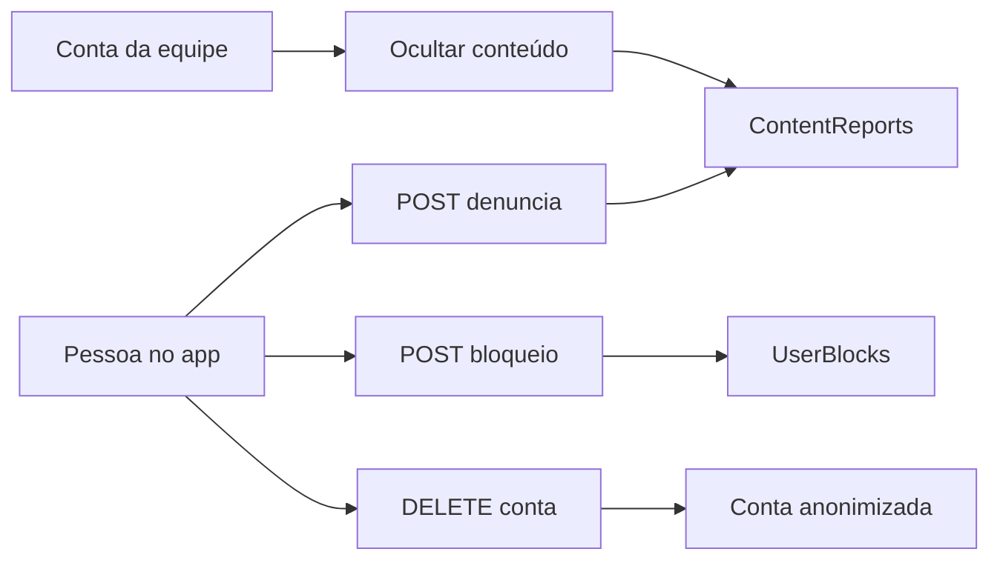

# Play Console: arquivo de respostas e correções no app

O arquivo em Downloads sai primeiro, com as respostas para colar no console **depois** que o app publicado tiver denúncia, bloqueio e exclusão. Até lá, a pergunta de moderação continua **Não**.

O aceite das regras **já existe** no cadastro (`TermsAcceptedAt` em [User.cs](c:\Users\Micro\source\repos\backend\EncontrameApi\EncontrameApi.Domain\Entities\User.cs) e o checkbox em [signup-form-section.tsx](c:\Users\Micro\source\repos\frontend\EncontrameApp\src\features\signup\sections\signup-form-section.tsx)). Não será refeito. O texto de [regras-content.ts](c:\Users\Micro\source\repos\frontend\EncontrameApp\src\features\regras\regras-content.ts) ganha a denúncia e o bloqueio no grupo e no aviso, no lugar de só citar o e-mail do caso.

A política **não** vai nomear um fornecedor de modelo nem afirmar que a conversa não entra em treino. Isso fica para quando você confirmar o contrato da Sofia. O texto só descreve o que já é verdade: a API lê a conversa para gerar a resposta, não vende e não usa para anúncio.

Branches novas a partir da `main`, sem commit: `feature/play-moderacao-exclusao` nos dois repositórios.

## 1. Arquivo em Downloads

Criar `C:\Users\Micro\Downloads\encontrame-play-console-respostas.md` com as 11 tarefas, as respostas corrigidas (política já no ar, exclusão **Sim** com `#exclusao-de-conta`, moderação **Sim** só depois deste app no ar) e a lista do que continua só na sua conta: conta de teste, AAB em HTTPS, e-mail `contato@nexoraprism.com.br`, teste fechado e os 12 testadores.

## 2. API — denúncia, bloqueio e ação da equipe

Em [EncontrameApi](c:\Users\Micro\source\repos\backend\EncontrameApi), no fluxo Controller, Service, repositório e migration:

- `ContentReport`: quem denunciou, tipo (`GroupMessage`, `MissingPerson`, `SafetyNote`), id do alvo, motivo curto, status `Open`.
- `UserBlock`: par único de quem bloqueia e quem foi bloqueado.
- `POST /api/Moderation/reports` e `POST`/`DELETE /api/Moderation/blocks`, com conta logada. Não denuncia a si mesmo. Alvo inexistente devolve 404.
- Mensagens do grupo ([GroupService.cs](c:\Users\Micro\source\repos\backend\EncontrameApi\EcontrameApi.Application\Services\GroupService.cs)) deixam de voltar para quem bloqueou o autor, e também somem para todo mundo se a equipe ocultou a mensagem.
- Aviso de segurança e ficha de pessoa somem das listagens públicas quando ocultos. O bloqueio de uma pessoa **não** apaga a ficha para o resto do app: some só para quem bloqueou.
- Equipe: `Moderation:StaffUserIds` no `appsettings`. Essas contas listam denúncias abertas e ocultam o alvo. Sem tela de admin no celular. Lista vazia significa que ninguém chama esses endpoints.

Testes unitários do service e de integração dos endpoints (sucesso, 401, 404, bloqueio filtrando mensagem).

## 3. API — exclusão de conta

`DELETE /api/Auth/me`, autenticado, em [AuthController.cs](c:\Users\Micro\source\repos\backend\EncontrameApi\EncontrameApi.Api\Controllers\AuthController.cs) e [AuthService.cs](c:\Users\Micro\source\repos\backend\EncontrameApi\EcontrameApi.Application\Services\AuthService.cs):

- Apaga tokens de sessão e as mensagens da Sofia.
- No lugar de apagar a linha do usuário (as fichas têm `UserId`), anonimiza: nome “Conta excluída”, CPF, e-mail, telefone, endereço, senha e id do Google zerados, e-mail único inválido para a conta não entrar de novo.
- Fichas, fotos, avistamentos e mensagens de grupo permanecem, como a política já promete. O nome exibido no grupo passa a ser o da conta anonimizada.
- Testes: conta some do login, Sofia some, ficha continua.

## 4. App

Novo `src/services/moderation/` com mock e axios, no padrão dos outros services.

- Grupo: em cada mensagem de outra pessoa, denunciar e bloquear. Mensagem bloqueada sai da lista.
- Caso: o botão que hoje abre e-mail em [pessoa-detalhe.controller.ts](c:\Users\Micro\source\repos\frontend\EncontrameApp\src\features\pessoa-detalhe\pessoa-detalhe.controller.ts) grava a denúncia na API e a tela diz que o pedido foi registrado. Correção de caso continua por e-mail. Entra também bloquear quem publicou, e a ficha deixa de aparecer para quem bloqueou.
- Aviso de segurança: o “Denunciar” de [inicio.controller.ts](c:\Users\Micro\source\repos\frontend\EncontrameApp\src\features\inicio\inicio.controller.ts) grava na API. O histórico de avistamentos é um mapa sem autor por pin; não ganha botão novo.
- Configurações: “Solicitar exclusão da conta” confirma e chama `DELETE /api/Auth/me`, sai da sessão e só então diz que a conta foi apagada. Se a API falhar, a tela não confirma. O e-mail continua na página web para quem não tem o app instalado.
- Textos novos em `en.ts` e `es.ts`. Central de Ajuda e [public/privacidade/index.html](c:\Users\Micro\source\repos\frontend\EncontrameApp\public\privacidade\index.html) passam a descrever o botão que apaga de verdade e o e-mail como caminho sem reinstalar.

## 5. Arquivos da ficha e verificação

Em Downloads, junto do markdown: PNG 512×512 a partir de [assets/images/icon.png](c:\Users\Micro\source\repos\frontend\EncontrameApp\assets\images\icon.png) e gráfico 1024×500 com o nome Encontra-me, nas cores da marca, sem selo de órgão público.

`dotnet test` na API e `npm run check` no app. No navegador: denunciar e bloquear no grupo, denunciar um caso, excluir a conta de um usuário de teste e conferir que o login dessa conta não volta.